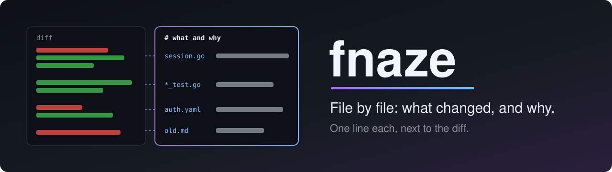

*[日本語](README_ja.md) | **English***

<a id="top"></a>

<div align="center">



**Describe each set of changes file by file — what changed and why, one line each.<br>A CLI and MCP server.**

[](https://github.com/amisonnet8/fnaze/actions/workflows/ci.yml)
[](https://github.com/amisonnet8/fnaze/releases)
[](LICENSE)
[](go.mod)
[](docs/reference/commands.md#fnaze-mcp---allow-write)

[Demo](#demo) · [Features](#features) · [Install](#install) · [Quick start](#quick-start) · [Usage](#usage) · [With git and AI agents](#workflow) · [Docs](#docs)

</div>

---

A commit message speaks for the whole set of changes at once; why each file was changed is left out. fnaze keeps, for one set of changes, a description file with one line per changed file saying what changed there and why. A reviewer reads that list to see where to look, and why.

<a id="demo"></a>

## 🎬 Demo

<p align="center">
  
</p>

`new` starts a group of description files (here in `en` and `ja`), carrying over the paths of the last one. `title` and `set` write it, and `status` reports what is left: here the Japanese file is not written yet. `show` prints one file as a tree, and `log` lists the groups. The image is made by a test from fnaze's real output.

<a id="features"></a>

## ✨ Features

- 📝 **One line per file**: for each changed file, what changed and why. A detail line can follow for the longer story
- 👀 **Made to be read**: `show` prints the file as a tree, with the descs in one column
- 🗂️ **Less to write for big changes**: a desc on a directory covers everything under it, and a pattern (`*_test.go`) covers the files it matches
- 🌐 **Several languages, kept in step**: one file per language in a group. `status` reports the files of a group whose paths differ
- 🩺 **Checks for hooks and CI**: `status --require` fails on an empty title, a file without a desc, a broken file or a language mismatch
- 🔌 **A built-in MCP server**: with `fnaze mcp`, AI agents get the same features, with the same JSON as `--json`
- 🔒 **No git, nothing outside `.fnaze/`**: fnaze does not read or run git, or any other program. What one set of changes is (usually one commit) is up to you
- 📦 **A single binary**: written in Go, for Linux, macOS and Windows

<a id="install"></a>

## 📦 Install

Download the archive for your OS (Linux, macOS or Windows; amd64 or arm64) from [Releases](https://github.com/amisonnet8/fnaze/releases), and put `fnaze` (`fnaze.exe` on Windows) somewhere on your `PATH`. `checksums.txt` there lets you check the archive. The archive also holds the license texts of the libraries built into fnaze (`licenses/`).

With Go 1.27 or later, you can also build it yourself:

```bash
go install github.com/amisonnet8/fnaze/cmd/fnaze@latest
```

<details>
<summary><b>Shell completion</b></summary>

`fnaze completion <shell>` prints a completion script for `bash`, `zsh`, `fish` or `powershell`. It completes the commands, the options, the languages, the groups, and the paths of the file with their descs. See [Commands](docs/reference/commands.md#fnaze-completion-shell) for where to put it.

</details>

<a id="quick-start"></a>

## 🚀 Quick start

```bash
cd your-project
fnaze init                                      # make .fnaze/
fnaze new                                       # start a group (in en)
fnaze title "Extend the session lifetime on access"
fnaze set src/auth/session.go "Extend the lifetime on every access"
fnaze set config/auth.yaml "Set the default session.ttl to 30m" \
  --detail "Users reported sessions expiring too soon"
fnaze status --require                          # anything left to write?
fnaze show                                      # read it back
```

For several languages, start the group with `fnaze new en ja`, and write each one with `--lang ja`. The next `fnaze new` uses the languages of the last group.

<a id="usage"></a>

## 🧭 Usage

A description file is plain text in `.fnaze/changes/<datetime>_<UUID>[_<language>].txt`: the title, then one entry per line, indented with tabs. A directory's paths are joined to the paths under it.

```
# Extend the session lifetime on access instead of fixing it
src/
	auth/	Change the session lifetime from fixed to extended
		session.go	Extend the lifetime on every access
		*_test.go	Add tests for the extension
config/auth.yaml	Set the default session.ttl to 30m
	| Users reported sessions expiring too soon
docs/old.md	Removed; its content moved to docs/auth.md
```

`show` prints it with the descs in one column (here the older of the two groups of [docs/examples/changes/](docs/examples/changes/), given by its short name):

```console
$ fnaze show 20261107T003426Z_8980
# Extend the session lifetime on access instead of fixing it

src/
  auth/           Change the session lifetime from fixed to extended
    session.go    Extend the lifetime on every access
    *_test.go     Add tests for the extension
config/auth.yaml  Set the default session.ttl to 30m
                  | Users reported sessions expiring too soon
docs/old.md       Removed; its content moved to docs/auth.md
```

`log` lists the groups, newest first (the times are in the local time zone, here `TZ=Asia/Tokyo`):

```console
$ fnaze log
20261107T021530Z_2c4c  2026-11-07 11:15  en,ja  3  Log session extensions
20261107T003426Z_8980  2026-11-07 09:34  en,ja  6  Extend the session lifetime on access instead of fixing it
```

| Command | What it does |
| --- | --- |
| `fnaze init` | Makes `.fnaze/` |
| `fnaze new [language…]` | Starts a group, one file per language, with the paths of the last file of each language |
| `fnaze title <title>` | Writes the title |
| `fnaze set <path> <desc> [--detail <detail>]…` | Writes one entry (and its detail) |
| `fnaze rm <path>` | Removes one entry |
| `fnaze status [--require] [--all \| group]` | Reports format errors, empty titles, empty descs and language mismatches |
| `fnaze show [group]` | Shows one file as a tree |
| `fnaze log` | Lists the groups, newest first |
| `fnaze mcp [--allow-write]` | Runs as an MCP server |
| `fnaze completion <shell>` | Prints a completion script |

The commands that work on a language take `--lang <language>` (or `FNAZE_LANG`; `en` when neither is given). Every command but `completion` takes `-C <dir>`, and the reading and writing commands print JSON with `--json`. See [Commands](docs/reference/commands.md) and [File format](docs/reference/file-format.md) for more.

<a id="workflow"></a>

## 🤝 With git and AI agents

fnaze does not decide what one set of changes is, and does not read git. A common way is one group per commit, put in the commit itself:

1. Stage the changes, and look at `git diff --cached --name-only`
2. `fnaze new`, then `fnaze title` and `fnaze set` for each changed file (an AI agent can do this through the MCP tools)
3. `fnaze status --require`, then commit the description files with the changes
4. The reviewer reads `fnaze show` (or the file in the pull request)

<details>
<summary><b>A git pre-commit hook</b></summary>

[docs/examples/pre-commit](docs/examples/pre-commit) stops a commit that adds no description file, or whose newest group `fnaze status --require` reports. Copy it to `.git/hooks/pre-commit` and make it executable. fnaze does not require it.

</details>

<details>
<summary><b>Registering with an MCP client</b></summary>

```json
{
  "mcpServers": {
    "fnaze": {
      "command": "fnaze",
      "args": ["mcp", "--allow-write"]
    }
  }
}
```

The reading tools are `show`, `status` and `log`. With `--allow-write`, the writing tools `new_group`, `set_title`, `set_description` and `remove_description` are offered too, and they write only inside `.fnaze/`. One server serves every language: each tool takes the language as an argument. See [Commands](docs/reference/commands.md#fnaze-mcp---allow-write) for more.

</details>

<details>
<summary><b>Example instructions for agents (CLAUDE.md and the like)</b></summary>

```markdown
## When committing
- Look at the staged files with `git diff --cached --name-only`.
- Start a group with `fnaze new`, write its title with `fnaze title`,
  and write one line per changed file with `fnaze set <path> <desc>`:
  what changed there, and why.
- Remove the carried-over paths that did not change with `fnaze rm <path>`.
- Run `fnaze status --require`, and commit `.fnaze/` with the changes.
```

</details>

<a id="docs"></a>

## 📚 Docs

| | |
| --- | --- |
| 💬 [Interactive guide](https://notebook.google.com/notebook/636aefcf-6a5b-42ab-a316-b1452c3709e1) | Ask questions to learn about fnaze (made with Gemini Notebook) |
| 🏛️ [docs/design/overview.md](docs/design/overview.md) | Design: what fnaze is for, and what it leaves out |
| 📐 [docs/reference/file-format.md](docs/reference/file-format.md) | Where the files are, their names, and how they are written |
| 📐 [docs/reference/commands.md](docs/reference/commands.md) | The commands, the JSON, the MCP tools and completion |
| 🧪 [docs/examples/](docs/examples/) | Example description files and a git pre-commit hook |

## 📄 License

[MIT](LICENSE)

---

<div align="center">
<sub><a href="#top">⬆ Back to top</a></sub>
</div>
