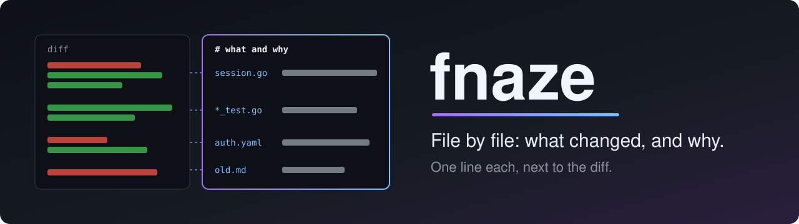

*[English](README.md) | **日本語***

<a id="top"></a>

<div align="center">



**変更のまとまりを、ファイルごとに説明する ——「何を、なぜ変えたか」を1行ずつ。<br>diff と並べてレビューできる。CLI と MCP サーバー。**

[](https://github.com/amisonnet8/fnaze/actions/workflows/ci.yml)
[](https://github.com/amisonnet8/fnaze/releases)
[](LICENSE)
[](go.mod)
[](docs/reference/commands_ja.md#fnaze-mcp---allow-write)

[デモ](#demo) · [特長](#features) · [インストール](#install) · [すぐに試す](#quick-start) · [使い方](#usage) · [git と AI エージェントと](#workflow) · [文書](#docs)

</div>

> 英語版が正本（`README.md`）。この文書はその日本語版。

---

diff は、何が変わったかを行ごとに見せる。なぜ変えたかは見せず、コミットメッセージは変更全体についてまとめて言う。fnaze は、変更のまとまり1つについて、説明のファイルを持つ。変えたファイルごとに、そこで何を、なぜ変えたかを1行で書く。レビューする人は、この一覧を diff と並べて読む。

<a id="demo"></a>

## 🎬 デモ

<p align="center">
  
</p>

`new` は、説明のファイルの組（ここでは `en` と `ja`）を作り、前の組のパスを写す。`title` と `set` で書き、`status` は残っているものを知らせる（ここでは、英語のファイルがまだ書かれていない）。`show` はファイル1つを木の形で見せ、`log` は組の一覧を出す。日本語のデモは `FNAZE_LANG=ja` で動かしている。この画像は、fnaze の実際の出力から、テストが作る。

<a id="features"></a>

## ✨ 特長

- 📝 **ファイルごとに1行**：変えたファイルそれぞれについて、何を、なぜ変えたか。長いいきさつは、detail の行で続けられる
- 👀 **diff と並べて読むための形**：パスは diff のパスで、木の形に書く。2つを横に並べて読める
- 🗂️ **大きな変更でも書くことが少ない**：ディレクトリの desc は、その下をまとめて説明する。パターン（`*_test.go`）は、当たるファイルをまとめて説明する
- 🌐 **いくつもの言語を、そろえて持つ**：組の中に、言語ごとにファイル1つ。パスが食い違う組は、`status` が知らせる
- 🩺 **フックと CI のための検査**：`status --require` は、空の題、desc の無いファイル、形の誤り、言語ごとのずれで失敗する
- 🔌 **MCP サーバーを内蔵**：`fnaze mcp` で、AI エージェントも同じ機能を使える。返す JSON は `--json` と同じ
- 🔒 **git を使わず、`.fnaze/` の外を書かない**：fnaze は git を読まず、呼ばない。ほかのプログラムも呼ばない。変更のまとまりを何にするか（ふつうはコミット1つ）は、使う人が決める
- 📦 **実行ファイル1つ**：Go で書かれ、Linux・macOS・Windows で動く

<a id="install"></a>

## 📦 インストール

[Releases](https://github.com/amisonnet8/fnaze/releases) から、OS（Linux・macOS・Windows。amd64 か arm64）に合うアーカイブを取ってきて、`fnaze`（Windows は `fnaze.exe`）を `PATH` の通った場所に置く。同じところの `checksums.txt` で、アーカイブを確かめられる。アーカイブには、fnaze に組み込まれたライブラリのライセンス文（`licenses/`）も入っている。

Go 1.27 以降があれば、自分でビルドしてもよい：

```bash
go install github.com/amisonnet8/fnaze/cmd/fnaze@latest
```

<details>
<summary><b>シェルの補完</b></summary>

`fnaze completion <shell>` が、`bash`・`zsh`・`fish`・`powershell` の補完のスクリプトを出す。コマンド、オプション、言語、組と、ファイルのパス（desc つき）を補完する。置き場所は [コマンド](docs/reference/commands_ja.md#fnaze-completion-シェル) を見る。

</details>

<a id="quick-start"></a>

## 🚀 すぐに試す

```bash
cd your-project
fnaze init                                      # .fnaze/ を作る
fnaze new                                       # 組を作る（en）
fnaze title "Extend the session lifetime on access"
fnaze set src/auth/session.go "Extend the lifetime on every access"
fnaze set config/auth.yaml "Set the default session.ttl to 30m" \
  --detail "Users reported sessions expiring too soon"
fnaze status --require                          # 書き残しは無いか
fnaze show                                      # 読み返す
```

いくつもの言語で書くときは、`fnaze new en ja` で組を作り、それぞれを `--lang ja` のように指定して書く。次の `fnaze new` は、前の組と同じ言語で作る。

<a id="usage"></a>

## 🧭 使い方

説明のファイルは、`.fnaze/changes/<日時>_<UUID>[_<言語>].txt` に置くテキスト。題のあとに、1行に1つずつエントリを、タブでインデントして書く。ディレクトリのパスは、その下のパスにつなげて読む。

```
# 認証のセッションの期限を、固定から延長に変えた
src/
	auth/	期限を固定から延長に変えた
		session.go	アクセスのたびに期限を延ばす
		*_test.go	延長のテストを足す
config/auth.yaml	session.ttl の既定を 30m にした
	| 短すぎてセッションが切れる報告があった
docs/old.md	消した。内容は docs/auth.md に移した
```

`show` は、desc の列をそろえて見せる（ここでは [docs/examples/changes/](docs/examples/changes/) の2つの組のうち古いほうを、短い名前で指定している）：

```console
$ fnaze show --lang ja 20261107T003426Z_8980
# 認証のセッションの期限を、固定から延長に変えた

src/
  auth/           期限を固定から延長に変えた
    session.go    アクセスのたびに期限を延ばす
    *_test.go     延長のテストを足す
config/auth.yaml  session.ttl の既定を 30m にした
                  | 短すぎてセッションが切れる報告があった
docs/old.md       消した。内容は docs/auth.md に移した
```

`log` は、組を新しい順に並べる（時刻は利用者のタイムゾーン。ここでは `TZ=Asia/Tokyo`）：

```console
$ fnaze log --lang ja
20261107T021530Z_2c4c  2026-11-07 11:15  en,ja  3  セッションの延長をログに出す
20261107T003426Z_8980  2026-11-07 09:34  en,ja  6  認証のセッションの期限を、固定から延長に変えた
```

| コマンド | すること |
| --- | --- |
| `fnaze init` | `.fnaze/` を作る |
| `fnaze new [言語…]` | 組を作る。言語ごとにファイル1つで、その言語の前のファイルのパスを写す |
| `fnaze title <題>` | 題を書く |
| `fnaze set <パス> <desc> [--detail <detail>]…` | エントリ1つ（と detail）を書く |
| `fnaze rm <パス>` | エントリ1つを消す |
| `fnaze status [--require] [--all \| 組]` | 形の誤り、空の題、空の desc、言語ごとのずれを知らせる |
| `fnaze show [組]` | ファイル1つを木の形で見せる |
| `fnaze log` | 組を新しい順に並べる |
| `fnaze mcp [--allow-write]` | MCP サーバーとして動く |
| `fnaze completion <shell>` | 補完のスクリプトを出す |

言語を扱うコマンドは `--lang <言語>` を取る（無ければ `FNAZE_LANG`、それも無ければ `en`）。`completion` のほかはどれも `-C <dir>` を取り、読む・書くコマンドは `--json` で JSON を出す。詳しくは [コマンド](docs/reference/commands_ja.md) と [ファイルの形式](docs/reference/file-format_ja.md) を見る。

<a id="workflow"></a>

## 🤝 git と AI エージェントと

変更のまとまりを何にするかを、fnaze は決めず、git も読まない。よくある使い方は、コミット1つにつき組1つで、そのコミットに一緒に入れる：

1. 変更をステージし、`git diff --cached --name-only` を見る
2. `fnaze new` のあと、`fnaze title` と、変えたファイルごとに `fnaze set` を打つ（AI エージェントは MCP の道具でもできる）
3. `fnaze status --require` を通し、説明のファイルを変更と一緒にコミットする
4. レビューする人は、`fnaze show`（またはプルリクエストの中のファイル）を diff と並べて読む

<details>
<summary><b>git の pre-commit フック</b></summary>

[docs/examples/pre-commit](docs/examples/pre-commit) は、説明のファイルを足さないコミットと、いちばん新しい組を `fnaze status --require` が報告するコミットを止める。`.git/hooks/pre-commit` に写して、実行できるようにする。fnaze はこれを強いない。

</details>

<details>
<summary><b>MCP クライアントへの登録</b></summary>

```json
{
  "mcpServers": {
    "fnaze": {
      "command": "fnaze",
      "args": ["mcp", "--allow-write"]
    }
  }
}
```

読む道具は `show`・`status`・`log`。`--allow-write` を付けると、書く道具 `new_group`・`set_title`・`set_description`・`remove_description` も出る。書くのは `.fnaze/` の中だけ。サーバー1つで、どの言語も扱う（道具ごとに、言語を引数で受ける）。詳しくは [コマンド](docs/reference/commands_ja.md#fnaze-mcp---allow-write) を見る。

</details>

<details>
<summary><b>エージェントへの指示の例（CLAUDE.md など）</b></summary>

```markdown
## コミットするとき
- ステージしたファイルを `git diff --cached --name-only` で確かめる。
- `fnaze new` で組を作り、`fnaze title` で題を書き、
  変えたファイルごとに `fnaze set <path> <desc>` で1行書く：
  そこで何を、なぜ変えたか。
- 写ってきたパスのうち、変わっていないものは `fnaze rm <path>` で消す。
- `fnaze status --require` を通し、`.fnaze/` を変更と一緒にコミットする。
```

</details>

<a id="docs"></a>

## 📚 文書

| | |
| --- | --- |
| 🏛️ [docs/design/overview_ja.md](docs/design/overview_ja.md) | 設計：fnaze が何のためにあり、何をしないか |
| 📐 [docs/reference/file-format_ja.md](docs/reference/file-format_ja.md) | ファイルの置き場所、名前、書き方 |
| 📐 [docs/reference/commands_ja.md](docs/reference/commands_ja.md) | コマンド、JSON、MCP の道具、補完 |
| 🧪 [docs/examples/](docs/examples/README_ja.md) | 説明のファイルの例と、git の pre-commit フック |

## 📄 ライセンス

[MIT](LICENSE)

---

<div align="center">
<sub><a href="#top">⬆ 先頭へ戻る</a></sub>
</div>
